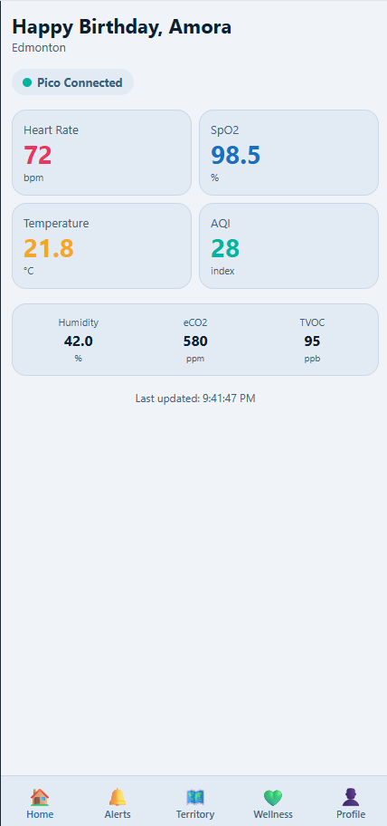
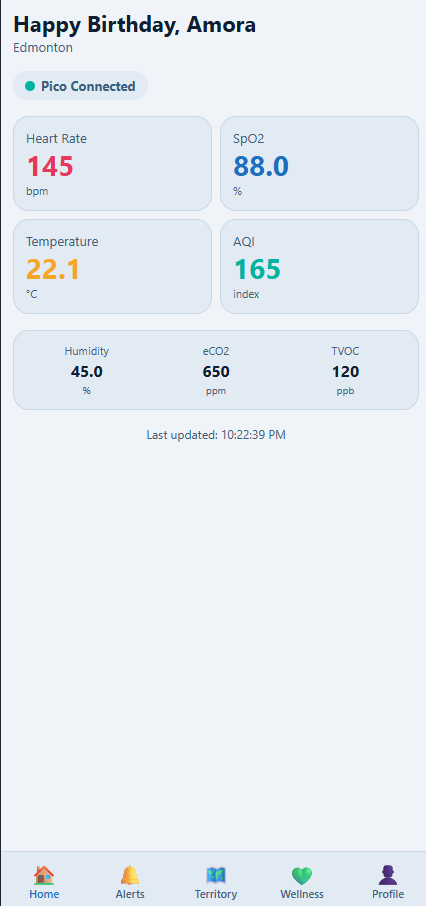
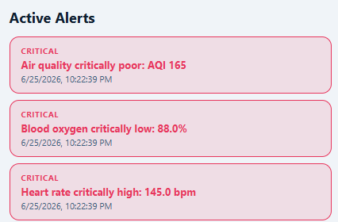
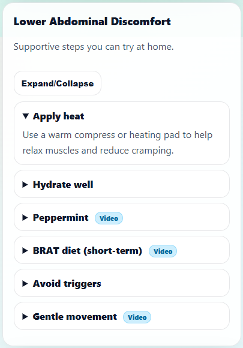
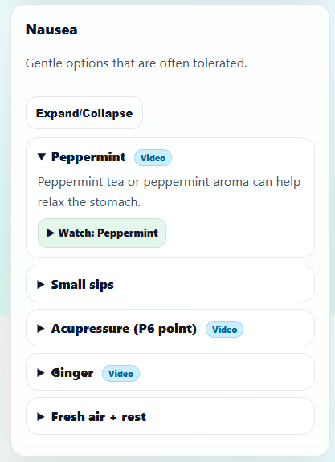
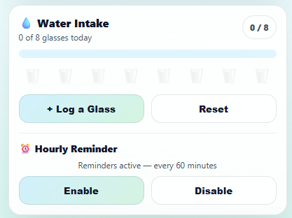
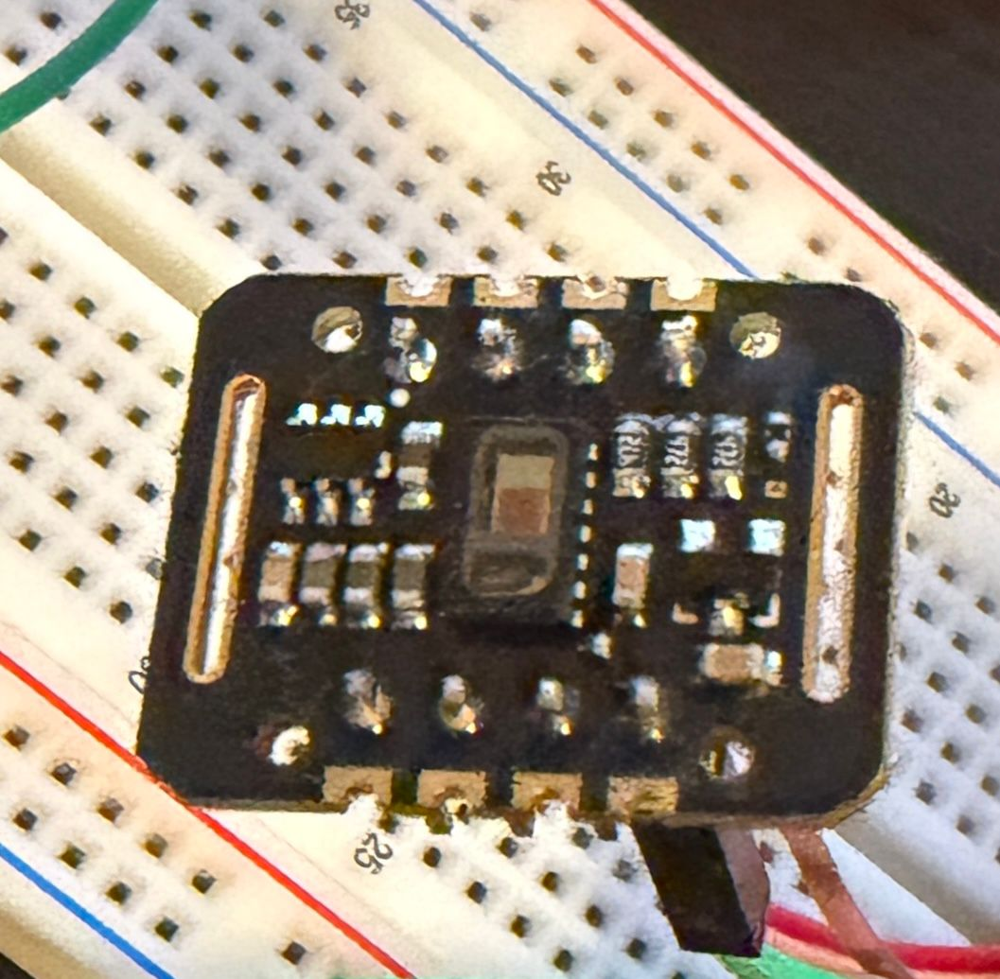
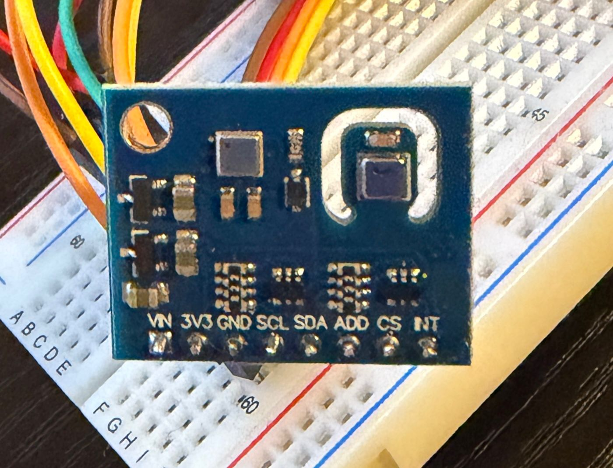

# SanzGo — Wearable Health & Wellness Platform

> **A gamified health monitoring platform that turns your daily run into a city-wide territory competition.**

---

## What is SanzGo?

SanzGo is a full-stack wearable health and wellness platform built around a Raspberry Pi Pico 2 W with medical-grade sensors. It monitors your physiological and environmental health in real time, sends intelligent health alerts, and lets you claim territory on a real map by physically running through your neighbourhood.

The platform consists of three components:
- A **FastAPI backend** that processes sensor data, manages territory, and sends health alerts
- A **web-based frontend** (mobile-first) for real-time health monitoring and territory management
- A **Raspberry Pi Pico 2 W** with three health sensors sending live physiological data

---

## Screenshots

| Normal Reading | Critical Reading | Active Alerts |
|---|---|---|
|  |  |  |

| Lower Abdominal Support | Nausea Relief | Water Intake Tracker |
|---|---|---|
|  |  |  |

---

## Hardware

| MAX30102 — Heart Rate & SpO2 | ENS160 — Air Quality Sensor |
|---|---|
|  |  |

---

## Tech Stack

| Layer | Technology |
|---|---|
| Backend | FastAPI (Python), asyncpg, PostgreSQL + PostGIS |
| Frontend | Plain HTML/CSS/JavaScript, jQuery, Mapbox GL JS |
| Database | PostgreSQL 16 with PostGIS 3.4 — Docker |
| Hardware | Raspberry Pi Pico 2 W |
| Sensors | MAX30102 (Heart Rate/SpO2), ENS160 (AQI/eCO2/TVOC), AHT21 (Temp/Humidity) |
| Auth | Google OAuth 2.0, JWT (HS256) |
| Map | Mapbox GL JS |
| Containerisation | Docker + Docker Compose |

---

## Hardware — Raspberry Pi Pico 2 W

The Pico 2 W connects three sensors via I2C on GP0/GP1:

| Sensor | Measures | Protocol |
|---|---|---|
| MAX30102 | Heart rate (bpm), Blood oxygen SpO2 (%) | I2C |
| ENS160 | Air Quality Index (AQI), eCO2 (ppm), TVOC (ppb) | I2C |
| AHT21 | Temperature (°C), Humidity (%) | I2C |

The device sends readings to `POST /sensor/add` using a device-specific API key. No JWT is required on this endpoint because the Pico has no secure storage.

---

## Health Alert System

SanzGo continuously monitors incoming sensor readings against medical thresholds and fires alerts automatically.

### Alert Thresholds

| Metric | Warning | Critical |
|---|---|---|
| Heart Rate (high) | > 100 bpm | > 130 bpm |
| Heart Rate (low) | < 50 bpm | < 40 bpm |
| Blood Oxygen SpO2 | < 95% | < 90% |
| Air Quality Index | > 100 | > 150 |

### Alert Severity Levels

- 🔴 **Critical** — Immediate danger. Requires urgent attention.
- 🟡 **Warning** — Elevated risk. Monitor closely.
- 🔵 **Info** — Advisory notice.

### Respiratory Condition Alerts

SanzGo includes pre-configured alert profiles for respiratory conditions detected through combined sensor readings:

**Pre-Asthma Indicators**
- Elevated TVOC combined with declining SpO2
- AQI above 100 sustained over multiple readings
- Heart rate elevation without physical activity context
- Alert sent immediately with recommended action steps

**Pneumonia Risk Indicators**
- Low SpO2 (below 94%) combined with elevated temperature
- Unusual breathing pattern detected through heart rate variability
- Sustained AQI degradation in enclosed spaces
- Alert escalated to critical if SpO2 drops below 90%

### Emergency Response — SMS Alert System

> ⚠️ **If a critical alert is not acknowledged within a configurable timeout window, SanzGo automatically escalates.**

When a critical health reading is detected and the user does not respond:

1. The system checks if the alert has been acknowledged in the app
2. If unacknowledged after the timeout, an SMS is sent automatically to:
   - The user's **pre-configured mobile number**
   - The user's **emergency contact**
3. The SMS includes:
   - The nature of the critical reading (e.g. SpO2 critically low at 88%)
   - The user's **last known GPS location** (latitude/longitude)
   - Timestamp of the reading
   - A direct link to the user's health dashboard

**Example SMS:**
```
SanzGo ALERT — Sandip Bohara
Blood oxygen critically low: 88.0%
Heart rate critically high: 145 bpm
Last location: 53.4680°N, 113.3720°W (Paisley, Edmonton)
Time: 2026-06-25 10:22 MST
— SanzGo Emergency System
```

This feature uses a pre-configured SMS provider (e.g. Twilio) and requires the user to set their mobile number and emergency contact in profile settings before it activates.

---

## Territory System — Gamification

> **Your daily run becomes a city-wide competition.**

### How It Works

1. Tap **Start Run** — the app begins collecting your GPS coordinates every second
2. Run a loop around any area — a block, a park, a building
3. Tap **End Run** — the app uploads your GPS path to the backend
4. The backend detects if your path forms a closed loop (within 10 metres of start)
5. Your loop is converted to a PostGIS polygon and stored as a territory zone
6. If your zone overlaps someone else's — only the overlapping portion is claimed
7. The previous owner receives a notification that their zone was stolen
8. Your zone appears on the map in your personal colour immediately

### Zone Rules

| Rule | Value |
|---|---|
| Minimum loop perimeter | 100 metres |
| GPS collection interval | Every 1 second |
| Loop closure distance | Within 10 metres of start |
| Overlap behaviour | Only the overlapping portion transfers |
| Defence | None — anyone who runs through steals it |
| Reclaim | Run the same loop again |

### Map Colours

| Colour | Meaning |
|---|---|
| Your zone colour | Zones you own |
| Other player colours | Zones owned by other users |
| No overlay | Unclaimed zones |

Each user picks their own unique zone colour on first login — no two players share the same colour.

---

## Wellness Page

The Wellness screen combines live sensor monitoring with daily health averages and curated health support content.

### Features

- **Live Now** — Heart rate, SpO2, temperature, AQI updating every 5 seconds
- **Today's Summary** — Daily averages calculated from all readings
- **Water Intake Tracker** — Log glasses, track progress toward 8-glass daily goal
- **Hourly Reminder** — Browser notification reminding you to hydrate every 60 minutes

### Health Support Content

| Condition | Content |
|---|---|
| Lower Abdominal Discomfort | Accordion with tips: heat therapy, hydration, BRAT diet, gentle movement |
| Nausea | Acupressure techniques, ginger, peppermint, small sips guidance |
| Stomach Ulcer Support | Cabbage juice, probiotics, aloe vera, turmeric guidance |
| Back Pain Relief | Searchable/filterable YouTube video library from NHS and Mayo Clinic |

> ⚠️ All wellness content is for general informational purposes only. Always consult a healthcare professional for medical advice.

---

## API Endpoints

### Authentication
| Method | Endpoint | Description | Auth |
|---|---|---|---|
| POST | `/auth/oauth` | Google OAuth login, returns JWT | None |

### Sensor Data
| Method | Endpoint | Description | Auth |
|---|---|---|---|
| POST | `/sensor/add` | Submit sensor reading from Pico | API Key |
| GET | `/sensor/latest/{device_id}` | Get latest reading | JWT |

### Alerts
| Method | Endpoint | Description | Auth |
|---|---|---|---|
| GET | `/alerts/current/{device_id}` | Active unresolved alerts | JWT |
| GET | `/alerts/history/{device_id}` | Full alert history | JWT |

### Wellness
| Method | Endpoint | Description | Auth |
|---|---|---|---|
| GET | `/wellness/summary/today` | Today's sensor averages | JWT |

### Territory
| Method | Endpoint | Description | Auth |
|---|---|---|---|
| POST | `/territory/run/upload` | Upload GPS run, claim zones | JWT |
| GET | `/territory/tiles` | GeoJSON zones near coordinates | JWT |
| GET | `/territory/leaderboard` | Top users by zones owned | JWT |

### Devices
| Method | Endpoint | Description | Auth |
|---|---|---|---|
| POST | `/devices/pair` | Pair a new Pico device | JWT |
| GET | `/devices/mine` | List paired devices | JWT |

### Profile
| Method | Endpoint | Description | Auth |
|---|---|---|---|
| POST | `/profile/setup` | Set zone colour on first login | JWT |
| GET | `/profile/me` | Get user profile and stats | JWT |
| PUT | `/profile/update` | Update name, city, colour | JWT |

---

## Database Schema

11 tables across health monitoring, territory, and user management:

```
users               — registered users with zone colour
user_identities     — Google/Microsoft OAuth identities
devices             — paired Raspberry Pi Pico devices
sensor_readings     — every reading from every sensor
alerts              — full alert history
current_alerts      — active unresolved alerts only
notifications       — push notifications (zone stolen, health alerts)
runs                — GPS run paths (PostGIS LineString)
territory_tiles     — claimed zone polygons (PostGIS Polygon)
territory_events    — full history of every zone claim and steal
user_settings       — per-user app preferences
```

---

## Local Development Setup

### Prerequisites

- Python 3.13+
- Docker Desktop
- Git

### 1. Clone the repository

```bash
git clone https://github.com/sandipbohara1/SanzGo.git
cd SanzGo
```

### 2. Create virtual environment

```bash
py -m venv .venv
.venv\Scripts\activate   # Windows
```

### 3. Install dependencies

```bash
pip install -r requirements.txt
```

### 4. Configure environment

Create a `.env` file in the root directory:

```env
APP_ENV=development

DB_HOST=localhost
DB_PORT=5433
DB_NAME=sanzgo
DB_USER=sanzgo_user
DB_PASSWORD=sanzgo_pass

JWT_SECRET=your_secret_key_here
JWT_ALGORITHM=HS256
JWT_EXPIRY_HOURS=24

GOOGLE_CLIENT_ID=your_google_client_id
GOOGLE_CLIENT_SECRET=your_google_client_secret

MAPBOX_ACCESS_TOKEN=your_mapbox_token
```

### 5. Start the database

```bash
docker compose up -d
```

### 6. Start the backend

```bash
uvicorn app.main:app --reload
```

Server runs at `http://127.0.0.1:8000`

### 7. Open the web app

Open the `web/` folder in VS Code and use **Live Server** to open `index.html`.

---

## Project Structure

```
SanzGo/
├── app/
│   ├── main.py              — FastAPI app entry point
│   ├── config.py            — Environment variable loading
│   ├── db.py                — asyncpg connection pool
│   ├── middleware.py        — JWT authentication middleware
│   └── routers/
│       ├── auth.py          — OAuth and JWT endpoints
│       ├── sensor.py        — Sensor data endpoints
│       ├── alerts.py        — Alert engine and endpoints
│       ├── wellness.py      — Wellness summary endpoint
│       ├── territory.py     — Territory and run endpoints
│       ├── devices.py       — Device pairing endpoints
│       └── profile.py       — User profile endpoints
├── web/
│   ├── index.html           — Dashboard (default screen)
│   ├── alerts.html          — Health alerts
│   ├── wellness.html        — Wellness + health support
│   ├── territory.html       — Mapbox territory map
│   ├── profile.html         — User profile
│   ├── login.html           — Google OAuth login
│   ├── css/                 — Page-specific stylesheets
│   └── js/                  — Page-specific JavaScript
├── assets/                  — Screenshots and hardware photos
├── docker-compose.yml       — PostgreSQL + PostGIS container
├── Dockerfile               — FastAPI container
├── requirements.txt         — Python dependencies
└── .env                     — Environment secrets (not committed)
```

---

## Built By

Sandip Bohara

---

## Licence

MIT
